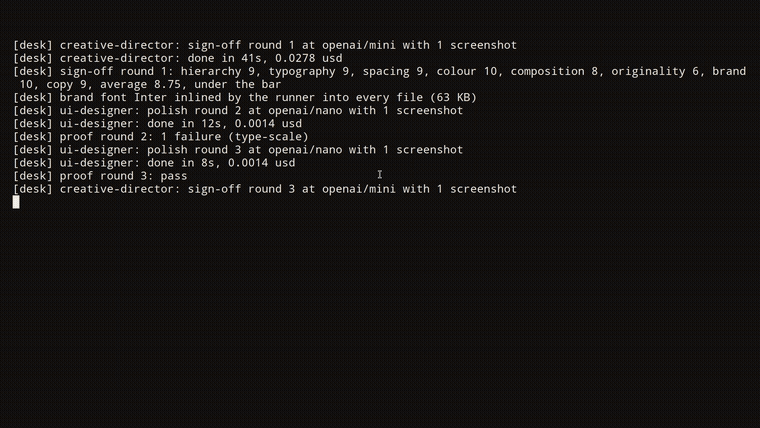

<p align="center"></p>

# Desk Studio

A full design studio inside the coding agent you already use. One command, free, nothing leaves your machine but the model calls you already make.

```
/plugin install desk --marketplace adityareddy-dev/deskstudio
npx deskstudio add
```

The first line is for Claude Code. The second is for Codex, Cursor, Gemini CLI, Copilot, Windsurf or OpenCode.

<p>
  <a href="https://www.npmjs.com/package/deskstudio"></a>
  <a href="https://github.com/adityareddy-dev/deskstudio/actions/workflows/check.yml"></a>
  <a href="LICENSE"></a>
  <a href="https://www.codetriage.com/adityareddy-dev/deskstudio"></a>
  <a href="https://github.com/adityareddy-dev/deskstudio/contribute"></a>
</p>

[deskstudio.ai](https://deskstudio.ai) · [Install](docs/install.md) · [Docs](#docs) · [Contribute](#contribute) · [Discussions](https://github.com/adityareddy-dev/deskstudio/discussions)

<a href="site/media/explainer.mp4"></a>

[Watch the 50-second explainer](site/media/explainer.mp4)

## 30-second example

Ask for something in your agent:

```
/desk:design a launch card for LinkedIn
```

Other agents read the block `npx deskstudio add` writes, so plain words work: "design a launch card for LinkedIn". Or run it yourself:

```
npx --package deskstudio desk-run design "a launch card for LinkedIn"
```

Files land in `.desk/out/<job>/` with a short note on who did what, the scores and the cost.

## What a run looks like

<a href="site/media/real-run.mp4"></a>

[Watch the real CLI capture](site/media/real-run.mp4)

The outputs, scores and cost are in [What it makes](docs/gallery.md).

## Why it exists

Cheap models make, strong models judge. Every visual job runs the way a studio runs: roughs, a pick, polish, proof, sign-off. The desks call models through the CLI you are already signed in to (`claude`, `codex` or `agy`) or a key (`ANTHROPIC_API_KEY`, `OPENAI_API_KEY`, `GEMINI_API_KEY`). `npx --package deskstudio desk-run doctor` shows which path it will take without making a model call. Scores come from the studio's model reviewers, they are not independent benchmarks.

## How it works

Three roughs on Sonnet, the pick on Opus, polish on Haiku, proof with no model, then the sign-off. The launch card job, retold with its real numbers. The five steps, the retry rules and the pixel checks are in [How a job runs](docs/how-it-works.md).

- 42 desks: the Design Manager and 41 that run as subagents. See [the team, cost and models](docs/team-and-cost.md) and [docs/roles.md](docs/roles.md).
- A local [dashboard](docs/dashboard-tour.md) to pause, move a desk to another model, write a desk a note or pick a rough yourself.
- It runs on your machine. The only things that leave it are the model calls the desks make and, for the few research desks, web lookups. The dashboard is 127.0.0.1 only with a token in the URL. See [docs/privacy.md](docs/privacy.md).

## Install and use

Claude Code:

```
/plugin install desk --marketplace adityareddy-dev/deskstudio
```

Other agents, one line in the project:

```
npx deskstudio add
```

It writes `.desk/`, copies the desks to `.agents/skills/desk/` and puts one marked block in the agent's instruction file. Every agent by default, one with `--agent codex`. The runner takes `design` for social cards for now; the other commands are Claude Code skills. Older Claude Code versions, the table of instruction files per agent, what each agent gets and the update rules are in [docs/install.md](docs/install.md).

Models are set once in `.desk/project.json`, or from the dashboard for one job:

```json
"models": {
  "director": "anthropic/opus",
  "senior": "anthropic/sonnet",
  "builder": "openai/nano"
}
```

Providers and roles are in [docs/providers.md](docs/providers.md) and [docs/runner.md](docs/runner.md). Proof also works on its own:

```
desk-proof check hero.html --brand .desk/DESIGN.md --sizes phone,desktop
```

## Contribute

Six jobs are open, and none of the checks need a model call. [Your first contribution](docs/first-contribution.md) has the files to read and the check to run for each small one.

- [Cursor setup guide](https://github.com/adityareddy-dev/deskstudio/issues/3) or [Copilot setup guide](https://github.com/adityareddy-dev/deskstudio/issues/4), for someone who uses that host.
- [Safe-zone boundary tests](https://github.com/adityareddy-dev/deskstudio/issues/5) or [required-copy tests](https://github.com/adityareddy-dev/deskstudio/issues/6), for someone comfortable with JavaScript.
- [Localization designer desk](https://github.com/adityareddy-dev/deskstudio/issues/1) or [form designer desk](https://github.com/adityareddy-dev/deskstudio/issues/2), for someone who wants to write a desk. Bigger than the rest.

Check that a job is open and unclaimed before starting. The [contribution guide](CONTRIBUTING.md) covers setup, source files and checks. Want to talk first, or show what you made? [Discussions](https://github.com/adityareddy-dev/deskstudio/discussions) is open, and [Show and tell](https://github.com/adityareddy-dev/deskstudio/discussions/categories/show-and-tell) is for finished pieces. To report a failed install, use the [issue templates](https://github.com/adityareddy-dev/deskstudio/issues/new/choose) with the host, version and exact command. Remove private project content from logs.

## Docs

[Commands](docs/commands.md), [the desks](docs/roles.md), [the dashboard](docs/dashboard.md), [cost](docs/cost.md), [the runner](docs/runner.md), [providers](docs/providers.md), [privacy](docs/privacy.md), [first contribution](docs/first-contribution.md), [install](docs/install.md), [what it makes](docs/gallery.md), [how a job runs](docs/how-it-works.md), [the team, cost and models](docs/team-and-cost.md), [the dashboard in use](docs/dashboard-tour.md).

To cite Desk Studio, use [CITATION.cff](CITATION.cff) or GitHub's **Cite this repository**.

## Licence

MIT.
