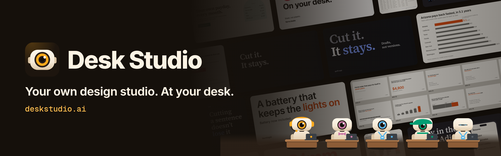
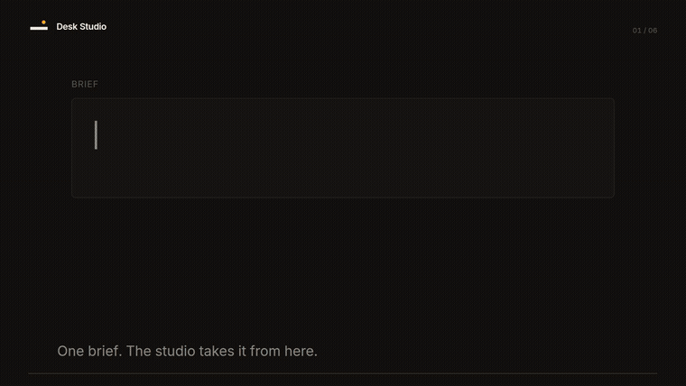
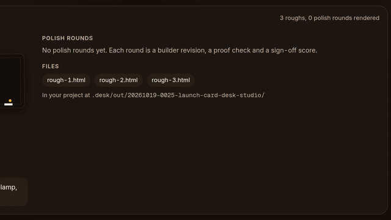
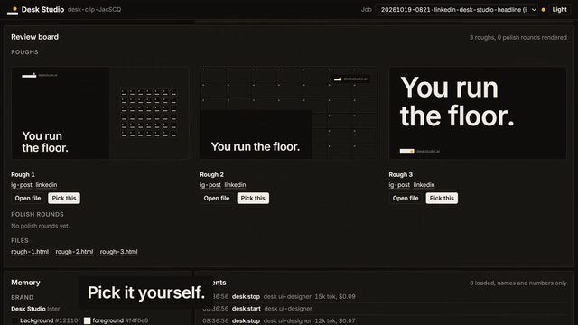
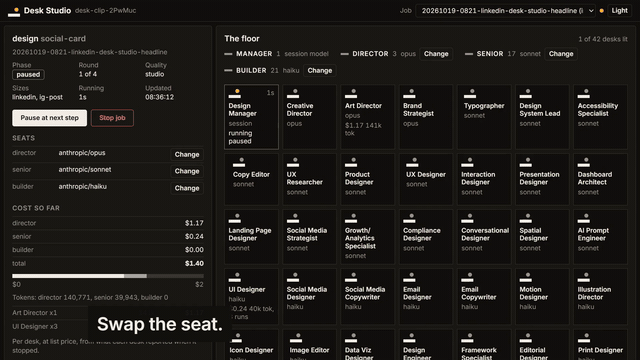
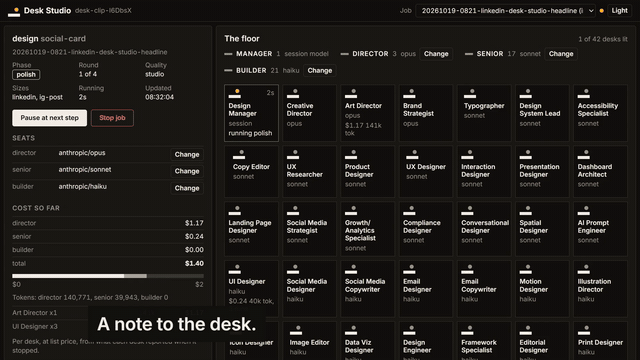
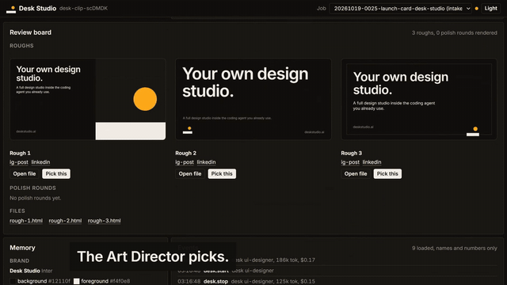
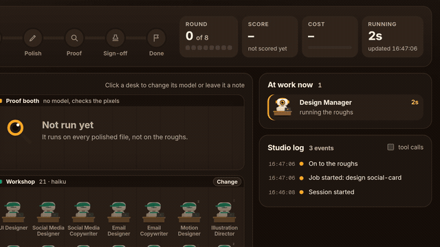
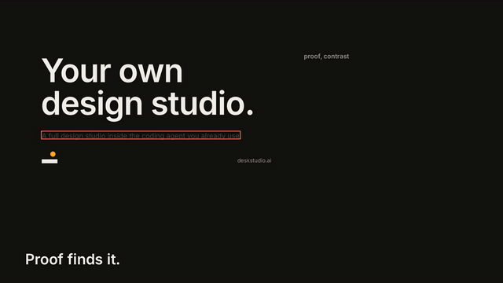

<p align="center"></p>

<p align="center">A full design studio inside the coding agent you already use.<br>One command, free, nothing leaves your machine but the model calls you already make.</p>

<p align="center">
  <a href="https://www.npmjs.com/package/deskstudio"></a>
  <a href="https://github.com/adityareddy-dev/deskstudio/actions/workflows/check.yml"></a>
  <a href="LICENSE"></a>
  <a href="https://www.codetriage.com/adityareddy-dev/deskstudio"></a>
  <a href="https://github.com/adityareddy-dev/deskstudio/contribute"></a>
</p>

<p align="center"><a href="https://deskstudio.ai">deskstudio.ai</a> · <a href="#install">Install</a> · <a href="#docs">Docs</a> · <a href="#contribute">Contribute</a> · <a href="https://github.com/adityareddy-dev/deskstudio/discussions">Discussions</a></p>

<br>

## One command, every style

<p align="center"></p>
<p align="center"><sub>Type one line in your agent. The wall is the 17 pieces the studio has signed off so far.</sub></p>

<br>

## How a job runs

<p align="center"></p>
<p align="center"><sub>Three roughs on Sonnet, the pick on Opus, polish on Haiku, proof with no model, then the sign-off. The launch card job, retold with its real numbers.</sub></p>

<br>

## Install

Claude Code:

```
/plugin install desk --marketplace adityareddy-dev/deskstudio
```

On a Claude Code older than 2.1.275, add the marketplace first, then install:

```
/plugin marketplace add adityareddy-dev/deskstudio
/plugin install desk@deskstudio
```

Then ask for something:

```
/desk:design a launch card for LinkedIn
```

Codex, Cursor, Gemini CLI, Copilot, Windsurf or OpenCode, one line in the project:

```
npx deskstudio add
```

It writes `.desk/`, copies the desks to `.agents/skills/desk/` and puts one marked block in the agent's instruction file. Every agent by default, one with `--agent codex`. Run it again any time, it keeps project text outside its markers and preserves edited desk briefs unless you pass `--force`.

| Agent | Where the block goes |
| --- | --- |
| Codex | `AGENTS.md` |
| OpenCode | `AGENTS.md` |
| Gemini CLI | `GEMINI.md` |
| Copilot | `.github/copilot-instructions.md` |
| Cursor | `.cursor/rules/desk.mdc` |
| Windsurf | `.windsurf/rules/desk.md` |

Then ask the agent in plain words, "design a launch card for LinkedIn", it reads the block and runs the studio. Or run it yourself:

```
npx --package deskstudio desk-run design "a launch card for LinkedIn"
```

The desks call models through the CLI you are already signed in to (`claude`, `codex` or `agy`) or a key (`ANTHROPIC_API_KEY`, `OPENAI_API_KEY`, `GEMINI_API_KEY`). `npx --package deskstudio desk-run doctor` shows which path it will take without making a model call.

The runner takes `design` for social cards for now. The other commands in the gallery below are Claude Code skills, see [command availability](docs/commands.md#command-availability).

Files land in `.desk/out/<job>/` with a short note on who did what, the scores and the cost.

## What it makes

17 signed-off pieces so far, for four made-up brands (Northlight, Quill, Ferro and Harbor), one real site whose brand the studio found in the project, and the studio's own. The score is the eight-axis average, rounded to one decimal, and the cost is list price for the whole job. Scores come from the studio's model reviewers, they are not independent benchmarks.

| Piece | Command | Score | Rounds | Cost |
| --- | --- | --- | --- | --- |
| [brand-kit for Desk Studio](evals/golden/brand-kit/desk-studio/renders/hero/desktop.png) | `/desk:brand-kit` | 8.6 | 3 | $11.60 |
| [brand-kit for harbor](evals/golden/brand-kit/harbor/renders/hero/desktop.png) | `/desk:brand-kit` | 8.6 | 2 | $10.16 |
| [carousel for quill](evals/golden/carousel/quill-drafts-beat-versions/renders/slide-01/ig-post.png) | `/desk:social-content` | 8.9 | 2 | $2.11 |
| [chart for northlight](evals/golden/chart/northlight-payback-by-state/renders/slide.png) | `/desk:chart-design` | 8.6 | 1 | $0.84 |
| [dashboard for northlight](evals/golden/dashboard/northlight-install-ops/renders/ready/desktop.png) | `/desk:dashboard-layout` | 8.5 | 3 | $6.21 |
| [deck for northlight](evals/golden/deck/northlight-pitch/renders/contact-sheet.png) | `/desk:presentation-design` | 8.5 | 4 | $7.93 |
| [email for ferro](evals/golden/email/ferro-welcome/renders/email-600-light.png) | `/desk:email-template` | 8.8 | 2 | $1.42 |
| [landing-page for quill](evals/golden/landing-page/quill-drafts/renders/desktop.png) | `/desk:design-template` | 8.5 | 2 | $2.12 |
| [motion-clip for quill](evals/golden/motion-clip/quill-launch-sting/renders/held-00000.png) | `/desk:motion-design` | 9 | 2 | $3.33 |
| [social-card for Desk Studio](evals/golden/social-card/desk-studio-floor/renders/linkedin.png) | `/desk:design` | 8.5 | 2 | $2.39 |
| [social-card for Desk Studio](evals/golden/social-card/desk-studio-launch/renders/linkedin.png) | `/desk:design` | 8.9 | 3 | $1.34 |
| [social-card for ferro](evals/golden/social-card/ferro-spec-reveal/renders/linkedin.png) | `/desk:design` | 8.8 | 2 | $0.80 |
| [social-card for northlight](evals/golden/social-card/northlight-battery-launch/renders/linkedin.png) | `/desk:design` | 8.6 | 2 | $0.97 |
| [social-card for northlight](evals/golden/social-card/northlight-battery-post/renders/linkedin.png) | `/desk:social-content` | 8.6 | 1 | $0.65 |
| [social-card for quill](evals/golden/social-card/quill-drafts-launch/renders/x.png) | `/desk:design` | 8.9 | 4 | $0.97 |
| [social-card for A Day in the Life of Adi](evals/golden/social-card/real-brand-site/renders/linkedin.png) | `/desk:design` | 8.5 | 4 | $1.23 |
| [video for ferro](evals/golden/video/ferro-spec-reveal/renders/f-00000.png) | `/desk:video` | 8.5 | 1 | $2.29 |

Every one of these is in [`evals/golden/`](evals/golden/) with its renders and its state, and the final file where the job kept one.

## Contribute

Six jobs are open, and none of the checks need a model call. [Your first contribution](docs/first-contribution.md) has the files to read and the check to run for each small one.

- [Cursor setup guide](https://github.com/adityareddy-dev/deskstudio/issues/3) or [Copilot setup guide](https://github.com/adityareddy-dev/deskstudio/issues/4), for someone who uses that host.
- [Safe-zone boundary tests](https://github.com/adityareddy-dev/deskstudio/issues/5) or [required-copy tests](https://github.com/adityareddy-dev/deskstudio/issues/6), for someone comfortable with JavaScript.
- [Localization designer desk](https://github.com/adityareddy-dev/deskstudio/issues/1) or [form designer desk](https://github.com/adityareddy-dev/deskstudio/issues/2), for someone who wants to write a desk. Bigger than the rest.

Check that a job is open and unclaimed before starting. The [contribution guide](CONTRIBUTING.md) covers setup, source files and checks. Want to talk first, or show what you made? [Discussions](https://github.com/adityareddy-dev/deskstudio/discussions) is open, and [Show and tell](https://github.com/adityareddy-dev/deskstudio/discussions/categories/show-and-tell) is for finished pieces. To report a failed install, use the [issue templates](https://github.com/adityareddy-dev/deskstudio/issues/new/choose) with the host, version and exact command. Remove private project content from logs.

## How it gets there

Every visual job runs the way a studio runs:

1. **Roughs.** The UI Designer makes three directions at the senior model from the brief, the brand and the standard for the piece.
2. **Pick.** The Art Director looks at the renders, picks one or combines, and writes the notes.
3. **Polish.** The builder desk revises with the notes and the screenshot. Rounds are cheap, so this is where the iteration goes.
4. **Proof.** Contrast on the rendered pixels, overflow, safe zones, palette, type scale, copy present. No model in the loop. A failure goes back to the builder with the screenshot. Proof runs on every polished file, not on the roughs.
5. **Sign-off.** The Creative Director scores eight axes: hierarchy, typography, spacing, colour, composition, originality, brand fit, copy. Pass is every axis at 8 or above and the average at 8.5 or above.

A builder that misses the same note twice hands the file to a senior. A senior that misses twice hands it to the Art Director for one round. After the cap, the job comes back marked under the bar, with a note naming the axis that fell short.

The launch card at the top went roughs, pick (rough 2: headline reads first at both sizes, only amber is the small lamp, fixes are type sizes not layout), then 8.4, 8.5, 8.9 over 3 rounds, signed off at 8.9.



## The dashboard

`/desk:dashboard setup` once, then `/desk:dashboard start`, opens a local page: 42 desks lit when active, the job's phase and round, the review board with every rough, pick and round, the scorecard, and the cost by tier. Every control is a write to a file the Manager reads before its next step: pause, continue, stop, move a tier or a desk to another model, write a desk a note, pick a rough yourself, approve under the bar or send back with notes.







One real job, run from the dashboard: paused after the roughs, the pick made by hand, the builder role moved from Haiku to Sonnet, and a note written to the UI Designer. It came back signed off at 8.5 in 2 rounds, $2.39 at list price.



## The team

42 desks, the Design Manager and 41 that run as subagents. Each is a written brief: what it owns, how it decides, its checklist and what it hands to the next desk. Full index in [docs/roles.md](docs/roles.md).

**Directors** (the pick, the notes, the sign-off, default `anthropic/opus`): Creative Director, Art Director, Brand Strategist.

**Seniors** (the roughs, research, type, tokens, copy, default `anthropic/sonnet`): Typographer, Design System Lead, Accessibility Specialist, Copy Editor, UX Researcher, Product Designer, UX Designer, Interaction Designer, Presentation Designer, Dashboard Architect, Landing Page Designer, Social Media Strategist, Growth/Analytics Specialist, Compliance Designer, Conversational Designer, Spatial Designer, AI Prompt Engineer.

**Builders** (every polish round, the making, default `anthropic/haiku`): UI Designer, Social Media Designer, Social Media Copywriter, Email Designer, Email Copywriter, Motion Designer, Illustration Director, Icon Designer, Image Editor, Data Viz Designer, Design Engineer, Framework Specialist, Editorial Designer, Print Designer, Storyboard Artist, Video Editor, Video/Content Producer, Content Designer, AI Image Director, AI Video Director, AI Audio & Voice Producer.

The Design Manager runs in your session on whatever model you run.

## What it costs

Cheap models make, strong models judge. Roughs come from the senior roles, every polish round from the builder roles, and the pick, the notes and the sign-off from the director roles.

| Tier | Default | Does |
| --- | --- | --- |
| director | `anthropic/opus` | the pick, the notes, the sign-off |
| senior | `anthropic/sonnet` | the roughs, research, type, tokens, copy |
| builder | `anthropic/haiku` | every polish round, the making |

The launch card above: $1.34 at list price. Director $0.81, senior $0.43, builder $0.10. 61% went to judgment, 39% to making, over 10 desk runs. How the dashboard counts it is in [docs/cost.md](docs/cost.md).



## Models per role

The runner reaches each provider through the CLI you already have signed in, on the plan you already pay for. API keys are the fallback. One provider is fine, and tiers can mix. Jobs have completed through the Anthropic, OpenAI and Google CLIs. Google uses Antigravity CLI. Set once in `.desk/project.json`, or from the dashboard for one job:

```json
"models": {
  "director": "anthropic/opus",
  "senior": "anthropic/sonnet",
  "builder": "openai/nano"
}
```

| Provider | CLI | Roles |
| --- | --- | --- |
| Anthropic | `claude` | director `opus`, senior `sonnet`, builder `haiku` |
| OpenAI | `codex` | director `large`, senior `mini`, builder `nano` |
| Google | `agy` | director `flash-high`, senior `flash`, builder `flash-low` |

`desk-run doctor` says which CLIs and keys are on the machine and what the defaults would be. Details in [docs/providers.md](docs/providers.md) and [docs/runner.md](docs/runner.md).

## Proof

Every polished file is rendered in Chrome at each size and checked on the pixels before the Creative Director scores it: text contrast against the pixels behind it, overflow and clipping, safe zones per platform, colours inside the brand palette, type on the brand scale, every line of copy present, carousels consistent across slides, reading time and flashes in motion. `desk-proof` works on its own too:

```
desk-proof check hero.html --brand .desk/DESIGN.md --sizes phone,desktop
```



## Other agents

| Agent | What you get |
| --- | --- |
| Claude Code | Everything: the 41 desks as native subagents with the repo's tools, the Manager in your session, the loop, proof, the dashboard, video. |
| Codex, Cursor, Gemini CLI, Copilot, Windsurf, OpenCode | `npx deskstudio add` writes a rules block the agent reads and copies the desk briefs. The runner takes `design` for social cards, with the same loop, proof and dashboard, and desks return files rather than editing the repo. For design work inside the codebase the agent plays the Design Manager from the briefs. The other commands are Claude Code only for now. The installer is tested for each of these agents. Jobs have completed through the Claude, Codex and Antigravity CLIs. |

## Privacy

It runs on your machine. The only things that leave it are the model calls the desks make and, for the few research desks, web lookups. The dashboard is 127.0.0.1 only with a token in the URL. The event log holds names, numbers and paths, never the prompt text. See [docs/privacy.md](docs/privacy.md).

## Docs

[Commands](docs/commands.md), [Codex setup](docs/codex.md), [the desks](docs/roles.md), [the dashboard](docs/dashboard.md), [cost](docs/cost.md), [the runner](docs/runner.md), [providers](docs/providers.md), [privacy](docs/privacy.md), [first contribution](docs/first-contribution.md).

To cite Desk Studio, use [CITATION.cff](CITATION.cff) or GitHub's **Cite this repository**.

## Licence

MIT.
