# The dashboard

The dashboard is a page on your own machine where you watch the studio work and steer it. Every desk is a small bot at its own desk. A bot wakes up while its desk is working and goes back to sleep when it is done. The job moves along a track from the brief to the sign-off, and the review board shows every rough, the pick and each round's score.

[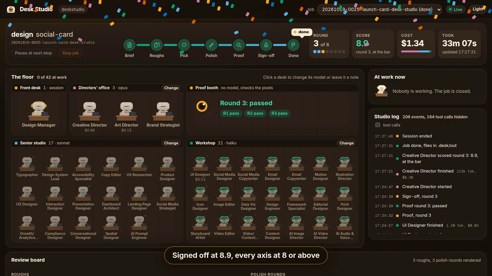](../site/media/walkthrough.mp4)

The clip above is a real job from this repo, the launch card in `clips/fixtures/card`, replayed and sped up. Fifty seconds, with captions.

## Open it

In Claude Code, once per project:

```
/desk:dashboard setup
/desk:dashboard start
```

`start` prints a link like `http://127.0.0.1:7433/?token=...`. Open it in your browser. The token changes on every start, and `/desk:dashboard status` prints the link again. `stop` ends the server and `disable` turns the dashboard off for the project.

Outside Claude Code (Codex, Cursor, Gemini CLI, Copilot, Windsurf, OpenCode or a plain terminal), the same commands come with the npm package:

```
npx --package deskstudio desk-dashboard setup
npx --package deskstudio desk-dashboard start
```

Add `--project DIR` for another folder and `--port N` for another port. The page only listens on 127.0.0.1 and every request needs the token.

Then start a job the usual way, `/desk:design a launch card for LinkedIn` in Claude Code, or ask your agent in plain words. The dashboard picks the job up by itself, there is nothing to refresh.

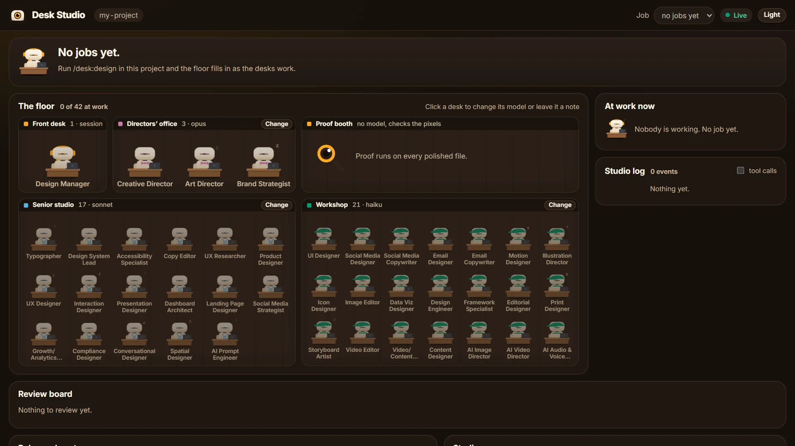

## What you see

### The job

The top of the page is the job you picked in the **Job** menu: the command and the deliverable, the job id, and a track with seven stations: Brief, Roughs, Pick, Polish, Proof, Sign-off, Done. The ticket sits on the station the job is at, and says which round it is on. Next to it are four numbers: the round out of the most allowed, the latest score, the cost so far and how long the job has been running.

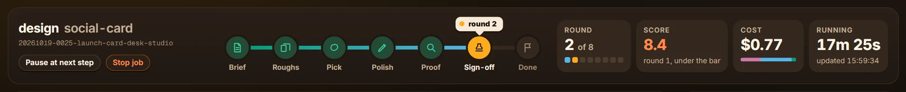

**Pause at next step** holds the job before its next step. **Stop job** ends it at the next step. Nothing interrupts a desk in the middle of a step.

### The floor

The 42 desks in four rooms, one per tier: the Front desk (the Design Manager), the Directors' office, the Senior studio and the Workshop, plus the Proof booth.

- A bot is **awake** while an agent of its desk is working: lens open, typing, its laptop lit in the tier colour, a bubble with its task and a timer under its name. A badge like ×3 means three agents of that desk are working at once, like the three roughs.
- A bot is **asleep** when nothing is running for it.
- A bot that is **half awake** is one the job lists as working with no live agent behind it. Usually that means the agent stopped without reporting.
- Under a desk's name you see what it has cost on this job, and its model when it has one of its own.
- Each room's sign says the model the tier is on. **Change** moves the whole tier to another model.
- The Proof booth shows the proof result of each round. Proof is a script that checks the rendered pixels, no model, so it has no bot.

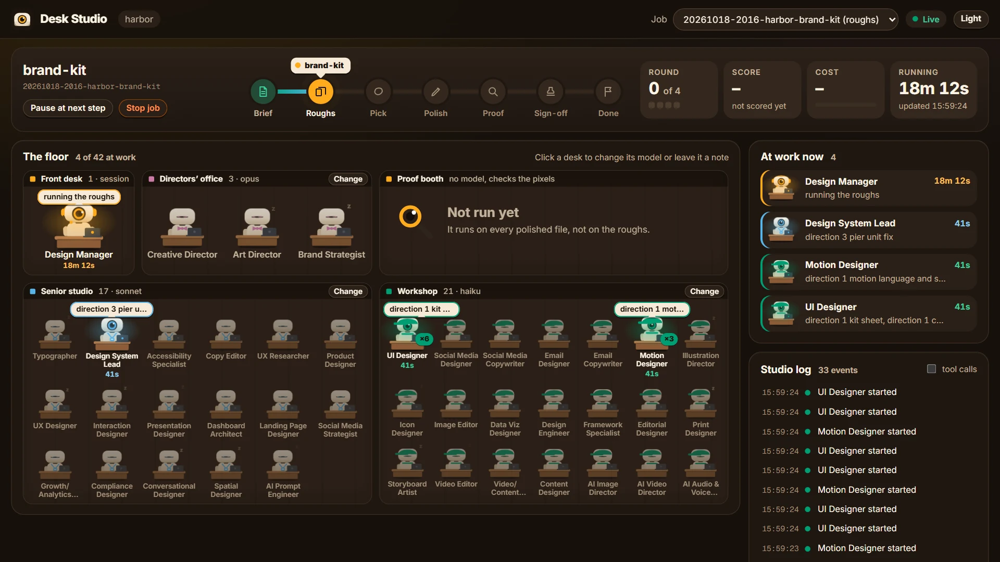

Click any desk to open its panel: what it owns, the model it is on, what it has done on this job, a model picker, and a box for a note. A note goes into that desk's next prompt on this job. The event log only records that a note was left and how long it was.

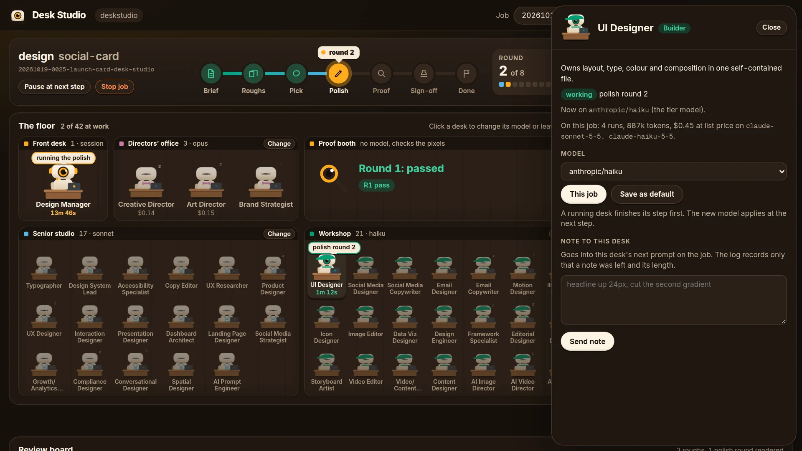

### At work now and the studio log

On the right, **At work now** lists every desk that is working, with its task, how long it has been at it and how many tools it has used. Under it, the **studio log** says what happened in plain words: a desk started or finished and what it cost, the job moved on, a round was scored, you paused or picked. Tick **tool calls** to see every tool call too.

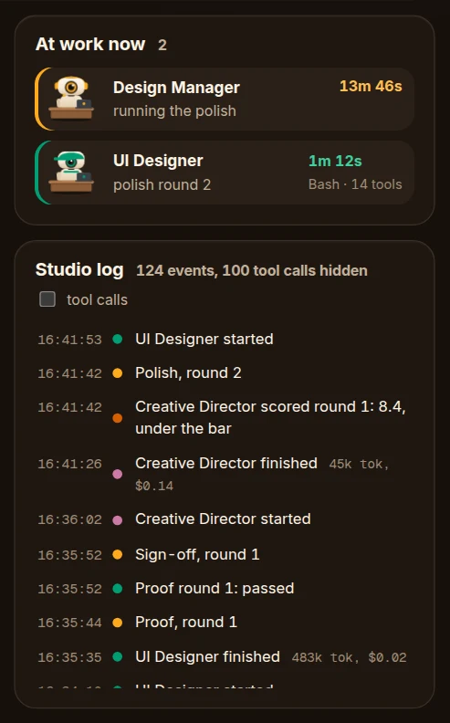

### The review board

The roughs are pinned on the left. The picked one gets a hand-drawn ring, with the Art Director's reason under it. **Pick this** on another rough picks it yourself: it overrides the Art Director at the pick step and is recorded as your call.

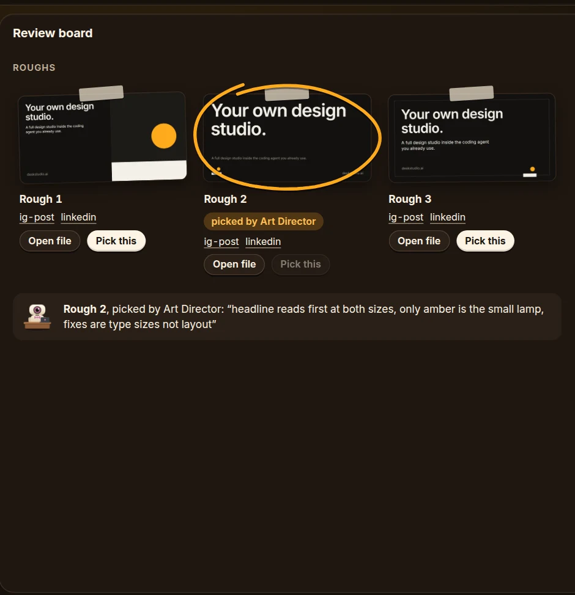

On the right, one tab per polish round with its average and its proof result, a line of the averages against the bar, and the selected round: its render, the proof result, and the Creative Director's eight scores. Click a tab to see an older round.

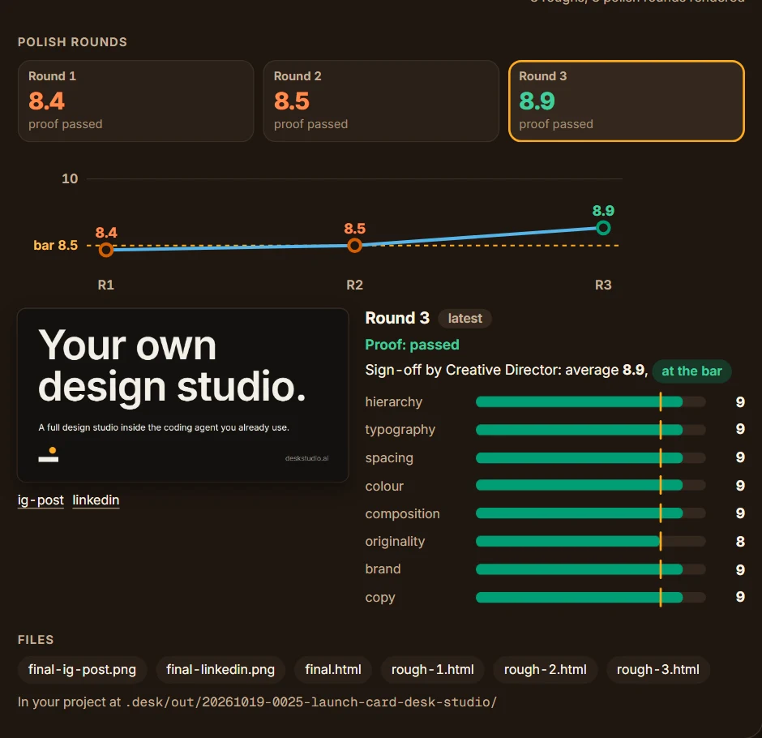

### Roles and cost

Which model each tier is on, the cost by tier at list price, a bar of the three, the tokens, the cost per desk, and **who did what**: every desk run on a time line, so you can see what ran side by side. The brief is folded at the bottom.

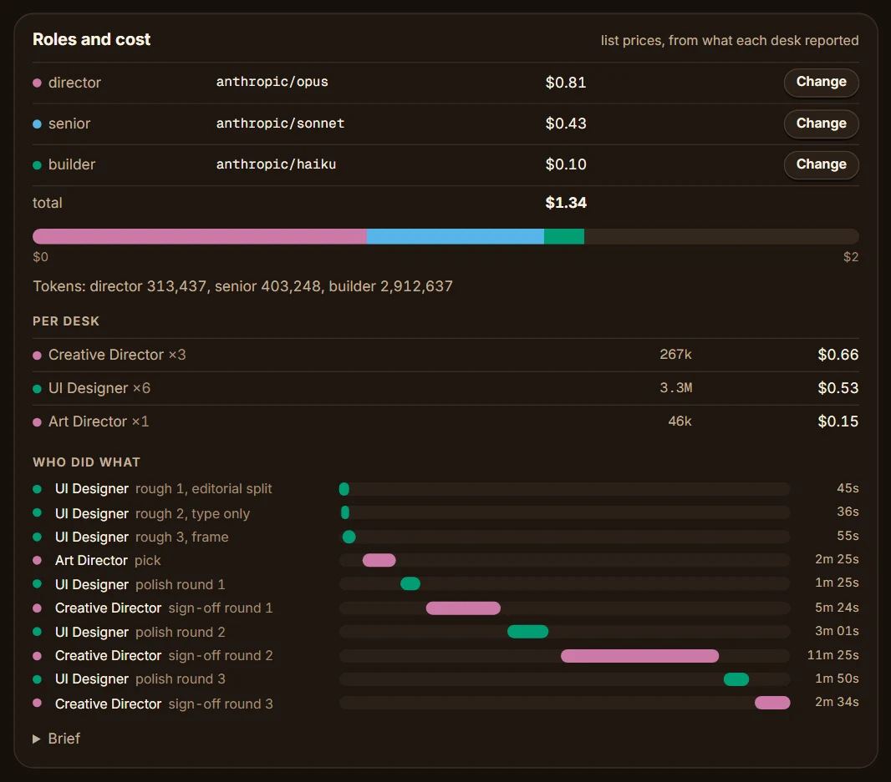

### Studio memory

The brand the desks read first (`.desk/DESIGN.md`: name, colours, type), `.desk/project.json` and `.desk/taste.md` when there is one.

## Follow a running job

1. Keep the page open while the job runs. A green **Live** at the top right means it is connected. If it says **Offline**, the server stopped: run `/desk:dashboard start` again and open the new link.
2. Watch the ticket move along the track and the bots wake up. **At work now** says who is on what right now.
3. When the roughs land, check the board. Pick one yourself if you disagree with the Art Director, before the pick step ends.
4. During polish, each round adds a tab with its score. A round under the bar goes round again on its own.
5. When the job needs you, an orange banner says so at the top: **Approve** keeps it as it is, recorded as your call, and **Send back** opens a box for what to change.

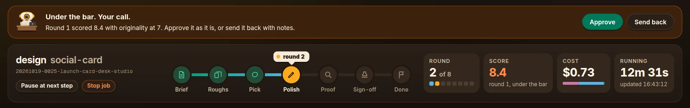

## Read the result

- The job is done when the ticket reaches **Done** and the score is green. Signed off means every one of the eight axes at 8 or above and the average at 8.5 or above.
- If the job came back **under the bar**, the score is orange and the round tabs show which axis fell short.
- The files are in your project at `.desk/out/<job>/`. The board links each one under **Files**: the final file, the renders at each size, and the roughs.
- The cost is at list price, from what each desk reported when it stopped. On a subscription you are not billed per token, so read it as an estimate.
- The score comes from the studio's own model reviewers. It is not an independent benchmark.

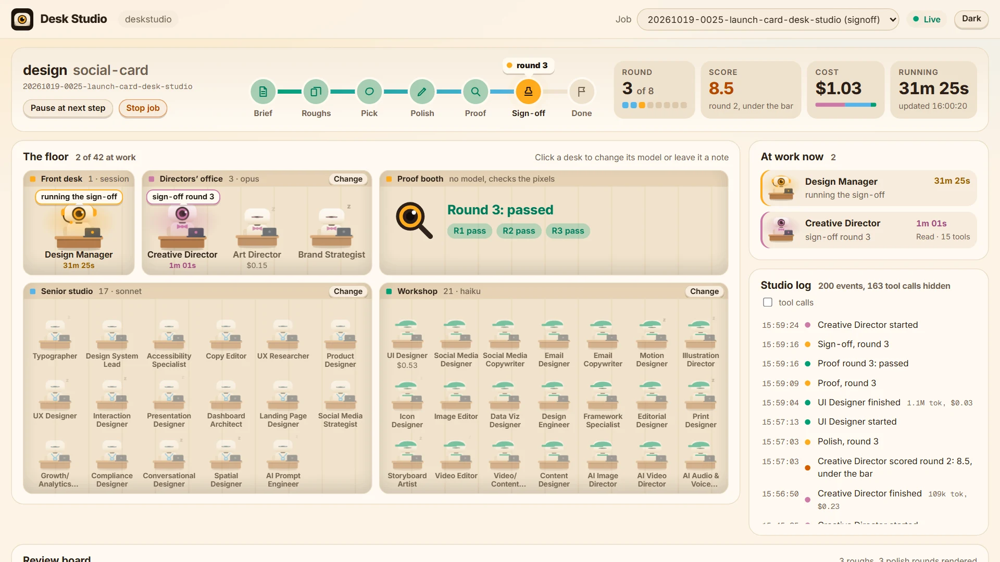

The **Light** and **Dark** button switches the scheme. That choice is the only thing the page keeps in your browser.

## What each control does

Every control is a write to a file the Design Manager reads before its next step. Nothing interrupts a desk mid-step. In native mode a running subagent cannot be stopped partway anyway, so pause means "hold at the next step" everywhere, and the button says so.

| Control | Where | What it writes |
| --- | --- | --- |
| Pause at next step, Continue | the job | `control.json` `paused: true` or `false` |
| Stop job | the job | `control.json` `stop: true` |
| Change model, "This job" | a room sign, a desk's panel, or Roles and cost | `control.json` `models.<tier>` or `models.desks.<desk>` |
| Change model, "Save as default" | the same | the above, and `models` in `.desk/project.json` |
| Use the tier model | a desk with its own model | removes `models.desks.<desk>` from `control.json` |
| Send note | a desk's panel | appends to `inbox/<desk>.md`, which the Manager puts in that desk's next prompt and then deletes |
| Pick this | a rough | `control.json` `pick: N`, which overrides the Art Director and is recorded as your call |
| Approve | the banner | `control.json` `approve: { at }` |
| Send back | the banner | `control.json` `sendBack: { notes, at }` |

Every control also appends one line to `.desk/events.jsonl`, type `control.<kind>`, with the job id and names or numbers: `paused`, the model names, the rough number, the desk a note went to and how long it was. Never the note itself.

Model names are `provider/model`, for example `anthropic/sonnet` or `openai/nano`. The picker lists the ones the project already uses plus the common ones, and takes any other name typed in.

## Where state lives

| Path | What |
| --- | --- |
| `.desk/dashboard.json` | `enabled` and `port`, written by `setup` |
| `.desk/dashboard.runtime.json` | pid, port and token of the running server, removed on `stop` |
| `.desk/dashboard.log` | start, stop, controls and errors, one line each |
| `.desk/events.jsonl` | the event log the dashboard tails |
| `.desk/jobs/<id>/state.json` | what the job, the floor and the review board show, kept by the Manager |
| `.desk/jobs/<id>/control.json` | your controls, merged key by key, read by the Manager |
| `.desk/jobs/<id>/inbox/<desk>.md` | your notes to a desk |
| `.desk/jobs/<id>/renders/rough-N/`, `round-N/` | the screenshots the board shows |
| `.desk/out/<id>/` | the files the desks made |

## Routes

All routes need the token, in the URL as `?token=` or in the header `X-Desk-Token`.

- `GET /api/health`: pid, port, start time.
- `GET /api/state`: project.json, the brand front matter, the jobs newest first, the active job, the desk list.
- `GET /api/jobs/:id`: state.json, control.json, the render folders with their PNGs, the out files, the brief, the inbox desks.
- `GET /api/events`: a server-sent event stream. The last 200 lines of the log on connect, then every new line. An extra `state` event fires when a state.json changes.
- `GET /api/file?path=`: a PNG, HTML, SVG or JSON file under `.desk/out` or `.desk/jobs` only. HTML and SVG are served sandboxed so a rough cannot run scripts against the dashboard.
- `POST /api/control/:id`: one of `{pause}`, `{stop}`, `{models, scope}`, `{pick}`, `{note}`, `{approve}`, `{sendBack}`.

## The screenshots and clips

The pictures on this page come from `node clips/shots.mjs`, and the clips on the site from `node clips/frames.mjs --all`. Both replay real job records from this repo (`clips/fixtures/` and `evals/golden/`) through the same files the Manager writes, on the real dashboard. The clips run the page on a virtual clock and take one screenshot per frame, so they are 60 frames a second.

## Tests

```bash
node --test "dashboard/test/*.test.mjs"
```
